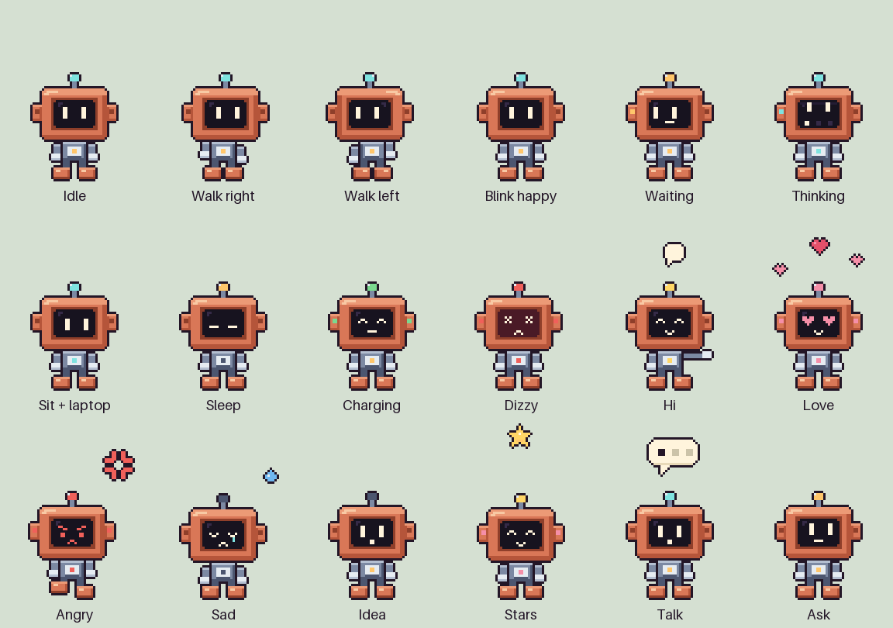

# Terra

A little pixel-art robot that lives on your Mac's desktop and keeps you company while you
work with [Claude Code](https://code.claude.com) or the [Claude desktop app](https://claude.ai/download).
It sits down at its computer when Claude starts working, asks when Claude needs you, cheers
when Claude is done, and waves when you say hi.



Terra is an Electron app for macOS. It stays on top of your windows in the bottom-right
corner, out of the way: only Terra itself catches the mouse, and clicks anywhere around it
go straight through to whatever is behind.

## What it does

- **Idles** and blinks, takes a **walk** along the bottom of the screen now and then, and
  **falls asleep** after 5 minutes of nothing happening. A click wakes it up.
- **Reacts** with an emote above its head: a speech bubble, hearts, a lightbulb, stars...
- **Follows Claude Code** once the hooks are connected, and **the Claude desktop app** once
  its tools are installed (see below).
- Click it and it loves you. Click it 5 times quickly and it gets dizzy. Drag it anywhere;
  it remembers the spot (and goes back to the corner if that screen is gone).
- Menu bar icon: **Play animation** and **Play reaction** to try everything, **Back to idle**,
  **Size** (1x, 1.5x, 2x, 3x or 4x), **Patrol** (walks on or off), **Start at login**,
  **Install in Claude desktop** and **Quit**. The top of the menu shows whether Terra is
  listening and whether the hooks and the Claude desktop tools are installed.

## Install

### The app

Build the disk image yourself (see [Build the app](#build-the-app)) or take
`Terra-<version>-arm64.dmg` (Apple Silicon) or `Terra-<version>-x64.dmg` (Intel) from a
release. Open the `.dmg` and drag **Terra** onto **Applications**.

Terra isn't signed with an Apple developer certificate or notarized, so the first time
you open it macOS blocks it ("Apple could not verify 'Terra' is free of malware"). To
open it anyway:

1. Open Terra from Applications once, and click **Done** on the warning.
2. Open **System Settings > Privacy & Security**, scroll down to *"Terra" was blocked...*,
   click **Open Anyway** and confirm.

Or, in Terminal: `xattr -dr com.apple.quarantine /Applications/Terra.app`, then open it
normally. You only have to do this once, and not at all for a copy you built yourself
(macOS only asks about apps that were downloaded).

Terra has no Dock icon. Look for its face in the menu bar.

### From source

Needs Node.js and npm.

```sh
git clone https://github.com/yassinsl/terra-pet.git
cd terra-pet
npm install
npm start
```

## Connect it to Claude Code

Terra hears about Claude Code through [hooks](https://code.claude.com/docs/en/hooks). One
command adds them to your Claude Code settings (`~/.claude/settings.json`):

```sh
# the app
/Applications/Terra.app/Contents/MacOS/Terra --install-hooks

# or from source
npm run hooks:install
```

The installer backs up `settings.json` first (`settings.json.terra-backup-<timestamp>`),
adds only Terra's own entries next to whatever you already have, and prints exactly what
it changed. Running it again changes nothing. It copies the small hook script to
`~/.terra-pet/terra-hook.sh` and points the hooks there, so they keep working wherever
the app lives. The menu then says **Hooks: installed**. If it says *needs update*, run the
command again.

The hook never slows Claude Code down: Claude Code doesn't wait for it, it gives up after
1 second, and it does nothing at all when Terra isn't running.

| When Claude Code... | Terra |
| :- | :- |
| gets your prompt | reacts if the prompt has a trigger word, then sits down to work |
| uses a tool | sits down to work, unless it already is |
| needs you (permission, waiting for input) | asks, with a question mark |
| finishes | is happy, with stars |
| stops on an API error (rate limit, overload...) | gets dizzy |
| starts a session | waves |

If Terra is left working or waiting for 10 minutes with no news from Claude Code (for
example after you press Esc, which sends no hook), it gets up and goes back to idle.
**Back to idle** in the menu does that right away.

## Claude desktop

Terra works with the Claude desktop app too, through a small local
[MCP server](https://modelcontextprotocol.io/docs/develop/connect-local-servers) that gives
Claude two tools. Claude decides when to call them:

| Claude calls... | When | Terra |
| :- | :- | :- |
| `terra_state("working")` | before a long answer or a multi-step task | sits down to work |
| `terra_state("done")` | when it has finished | is happy, with stars, then idles |
| `terra_state("waiting")` | when it needs your answer or approval | asks, with a question mark |
| `terra_state("idle")` | when it stops without finishing | stands up and idles |
| `terra_react("love")`, ... | when the moment has a feeling | plays that [reaction](#reactions), then goes back to what it was doing |

`terra_react` takes any of the eight reactions: `hi`, `love`, `angry`, `sad`, `idea`,
`stars`, `talk` or `ask`.

### Install the tools

1. Quit the Claude desktop app (**Claude > Quit Claude**, or Cmd+Q).
2. Add Terra to its config, with Terra's menu (**Install in Claude desktop**) or one command:

   ```sh
   # the app
   /Applications/Terra.app/Contents/MacOS/Terra --install-mcp

   # or from source
   npm run mcp:install
   ```

3. Open the Claude desktop app again. **It loads its tools only when it starts**, so if it
   was open while you installed, quit it completely (Cmd+Q, not just closing the window)
   and open it again.
4. Check it's there: click **+** (*Add files, connectors, and more*) in the message box
   and point at **Connectors**: **terra** should be in the list. The first time Claude uses
   a tool, the app may ask you to allow it; choose *Always allow* so it doesn't ask each time.
5. Optionally, tell Claude about Terra. In **Settings > General**, add this to *What
   personal preferences should Claude consider in responses?*:

   > You have a desktop pet called Terra. Use the terra tools to show what you are doing
   > and how the conversation feels.

The installer edits `~/Library/Application Support/Claude/claude_desktop_config.json`. It
backs the file up first (`claude_desktop_config.json.terra-backup-<timestamp>`), adds one
`terra` entry next to your other servers, and prints exactly what it changed. Running it
again changes nothing. It never adds a second Terra entry, and if you already have a server
called `terra` that isn't Terra's, it stops without changing anything.

The entry runs `mcp/terra-mcp.js` with Terra's own program, so you don't need Node.js. It
points into the copy of Terra you installed from: after moving Terra.app, or switching
between the app and the source, install again (the menu then says *installed for another
copy of Terra*). Install from `/Applications`, not from the disk image or Downloads.

Terra must be running for Claude to move it. If it isn't, the tools just tell Claude so
and nothing happens. Like the hooks, Terra gives up on *working* or *waiting* after 10
minutes with no news. If the tools don't show up, Claude's MCP logs are in
`~/Library/Logs/Claude` (`mcp.log` and `mcp-server-terra.log`).

## Reactions

| Reaction | Emote | Triggered by |
| :- | :- | :- |
| `hi` | "HI!" bubble, waving | a prompt with **hi**, **hello**, **hey** or **salam** |
| `love` | hearts | a prompt with **thanks**, **thank you**, **love** or **great**; clicking Terra |
| `idea` | lightbulb | a prompt with **idea** or **plan** |
| `angry` | angry mark | a prompt with **wtf**, **stupid**, **angry** or **broken again** |
| `stars` | stars, happy | Claude finishing |
| `ask` | question mark | Claude needing you |
| `talk` | "..." bubble | the menu; Claude desktop |
| `sad` | a tear | the menu; Claude desktop |

Claude desktop can play any of them (see [Claude desktop](#claude-desktop)).

Trigger words are matched as whole words, ignoring case, and only in what you typed: text
you paste into the prompt doesn't count. The first row that matches wins.

### Change the trigger words

The table lives in [`reactions.js`](reactions.js):

```js
const REACTIONS = [
  { reaction: 'hi',    words: ['hi', 'hello', 'hey', 'salam'] },
  { reaction: 'love',  words: ['thanks', 'thank you', 'love', 'great'] },
  ...
];
```

Add words, add rows, or reorder them. `reaction` must be one of the eight names above.
Restart Terra to pick up the change.

## Make your own skin or animation

All the art is in [`Bot/`](Bot):

- **`Bot/spritesheet-x1.png`**: the pet. 8 columns by 19 rows of 48x52 cells, one animation
  per row, on a transparent background. To reskin Terra, draw a new sheet with the same
  layout and replace this file.
- **`Bot/reactions/emotes-only/<name>-<n>.png`**: the emotes, numbered from 1. Each is a
  64x80 transparent canvas holding only the emote; the pet's 48x52 cell sits at x=8, y=28
  on that canvas, so an emote is drawn in the space above and around it.

To add an animation, give it a free row on the sheet and add a line to
[`renderer/animations.js`](renderer/animations.js):

```js
dance: { row: 19, frames: 6, ms: 120, plays: 2, next: 'idle' },
```

`ms` is the time per frame (one number, or one per frame), and an animation either has
`loop: true` or plays `plays` times and then goes to `next`. It shows up in the menu's
**Play animation** list by itself.

To add an emote, put its frames in `Bot/reactions/emotes-only/` and add a line to
[`renderer/emotes.js`](renderer/emotes.js) naming the frame count, the timing and the pet
animation it goes with. It then appears under **Play reaction**, and you can use its name
in `reactions.js`.

## Uninstall

1. Remove the hooks: `/Applications/Terra.app/Contents/MacOS/Terra --uninstall-hooks`
   (or `npm run hooks:uninstall`). Only Terra's entries are removed, and settings.json is
   backed up first.
2. Remove the Claude desktop tools: **Uninstall from Claude desktop** in the menu, or
   `/Applications/Terra.app/Contents/MacOS/Terra --uninstall-mcp` (or
   `npm run mcp:uninstall`). Only Terra's entry is removed, and the config is backed up
   first. Then quit and reopen the Claude desktop app.
3. If you turned on **Start at login**, turn it off in the menu.
4. Quit Terra from the menu and drag it from Applications to the Bin.
5. Optionally delete `~/.terra-pet` (the port file) and
   `~/Library/Application Support/Terra` (where Terra remembers its spot and size).

## Privacy

Terra runs entirely on your Mac. It has no network code apart from its listener, which
only accepts connections from your own Mac (`127.0.0.1`), where the hook sends its events. When you send a prompt, the hook passes its text to Terra,
which checks it for trigger words in memory and then drops it: prompt text is never written
to disk, logged, or sent anywhere else. The Claude desktop tools send Terra nothing but one
name from a fixed list (`love`, `working`, ...); the listener refuses anything else, so no
conversation text reaches Terra that way. Terra stores only its position and size.

## Development

```sh
npm start         # run from source
npm test          # every test, about 5 minutes
npm test -- unit  # the quick ones, no window
npm run dist      # build dist/Terra-<version>-arm64.dmg and -x64.dmg
npm run icons     # redraw the app and menu bar icons from the sprite sheet
```

The end-to-end tests run the real app: a second Terra appears and moves around for a few
minutes. Leave it alone and keep the screen on. They use temporary folders, so they never
touch your settings, your saved spot, or a Terra you are running.

### Build the app

`npm run dist` makes one `.dmg` for Apple Silicon and one for Intel in `dist/`. The app is
signed ad hoc (no certificate; Apple Silicon needs at least that to run it) and not
notarized, which is why macOS asks you to confirm the first time you open it.

### How it fits together

- `main.js`: the window, menu bar menu, mouse pass-through, patrol routes, hook events to
  states, and the 10-minute timeout
- `listener.js`: the local HTTP listener the hook and the MCP server talk to
  (`127.0.0.1:47800`, or the next free port, written to `~/.terra-pet/port`)
- `hooks/terra-hook.sh`: the Claude Code hook
- `hook-installer.js`: adds, removes and checks the hooks (`scripts/` wraps it for npm)
- `mcp/terra-mcp.js`: the MCP server for the Claude desktop app (stdio, official MCP SDK)
- `mcp-installer.js`: adds, removes and checks it in the Claude desktop config
- `pet-commands.js`: the names the Claude desktop tools may send
- `json-file.js`: safe edits (backup, symlinks, indentation) for both installers
- `reactions.js`: trigger words
- `window-state.js`: size, position and remembering them
- `renderer/`: the page that draws Terra: the state machine, animations and emotes
- `assets/`: the app and menu bar icons
- `test/`: unit and end-to-end tests (`test/run.js` runs them all)

See [CONTRIBUTING.md](CONTRIBUTING.md) if you'd like to help.

## License

[MIT](LICENSE). The art in `Bot/` is MIT too ([Bot/LICENSE](Bot/LICENSE)).
